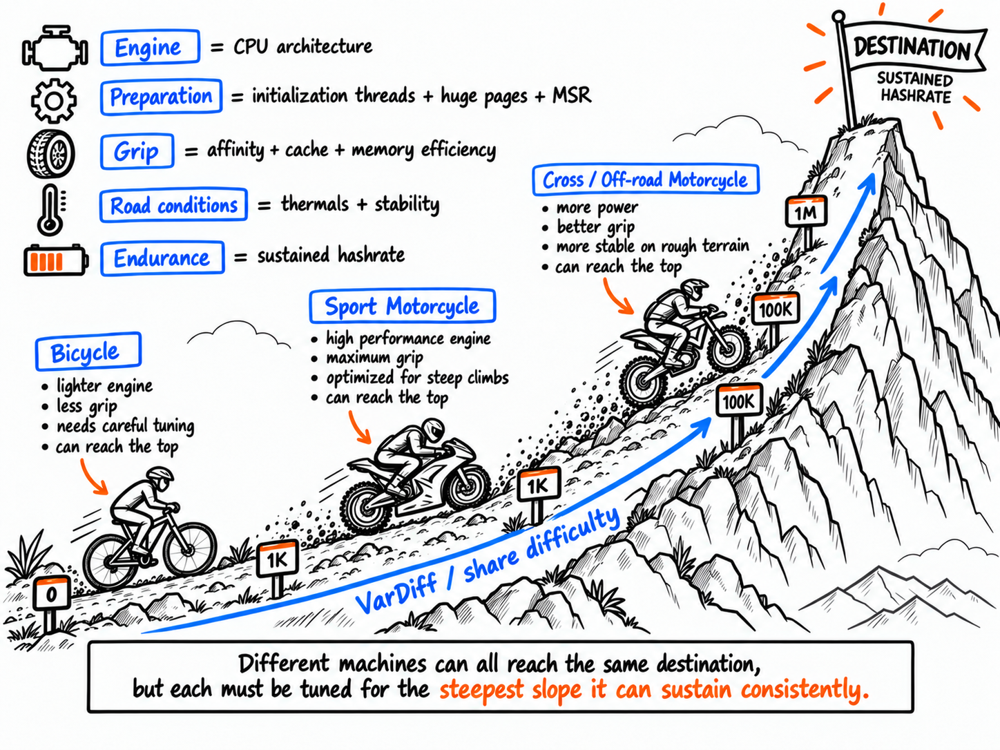
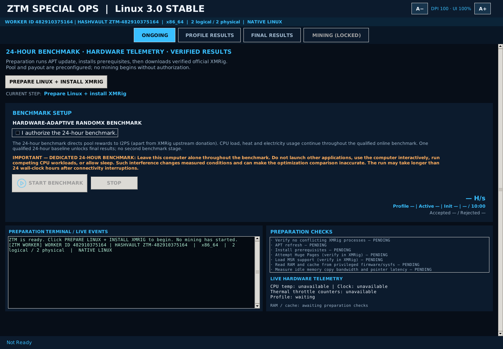
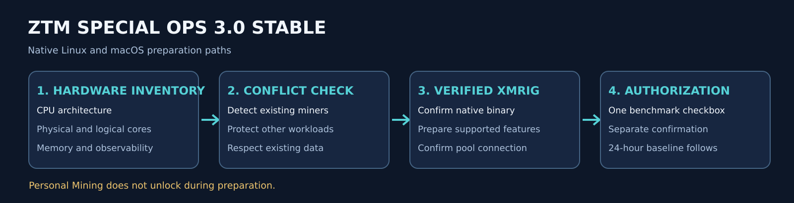
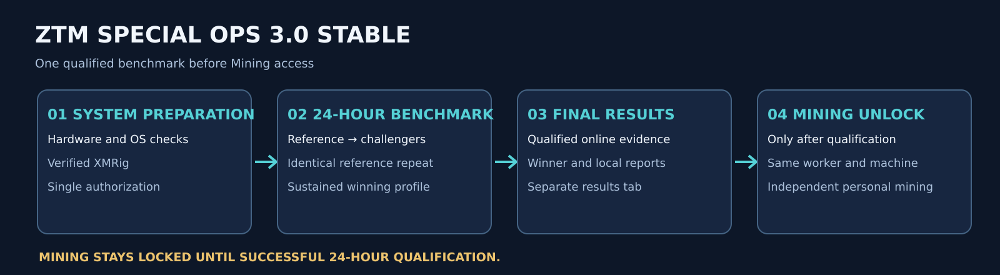
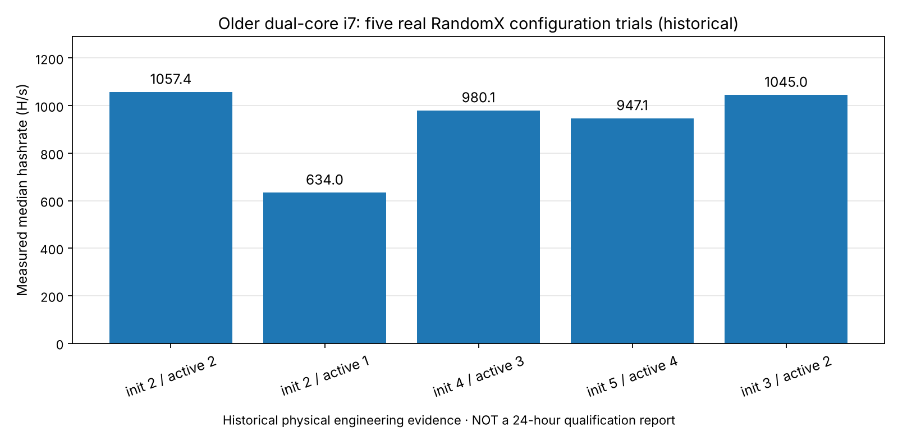
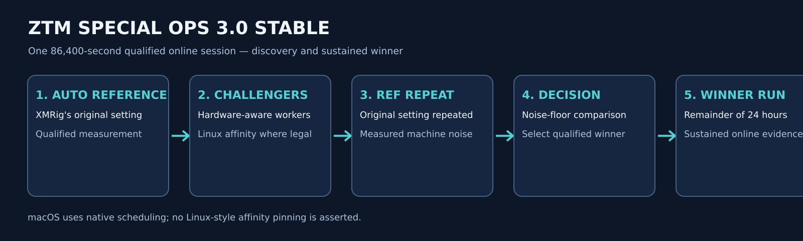
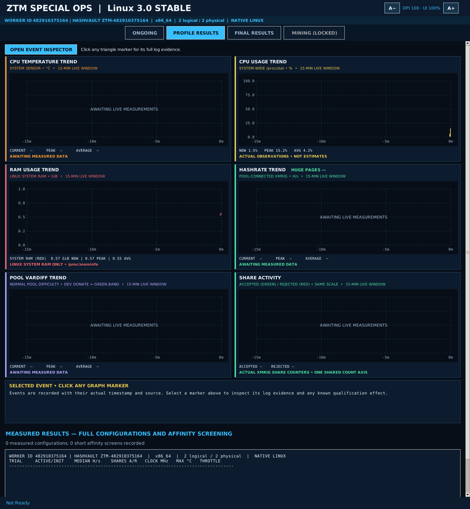
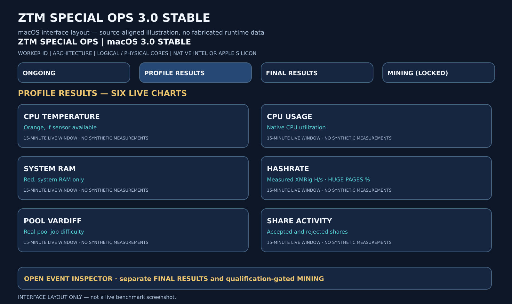
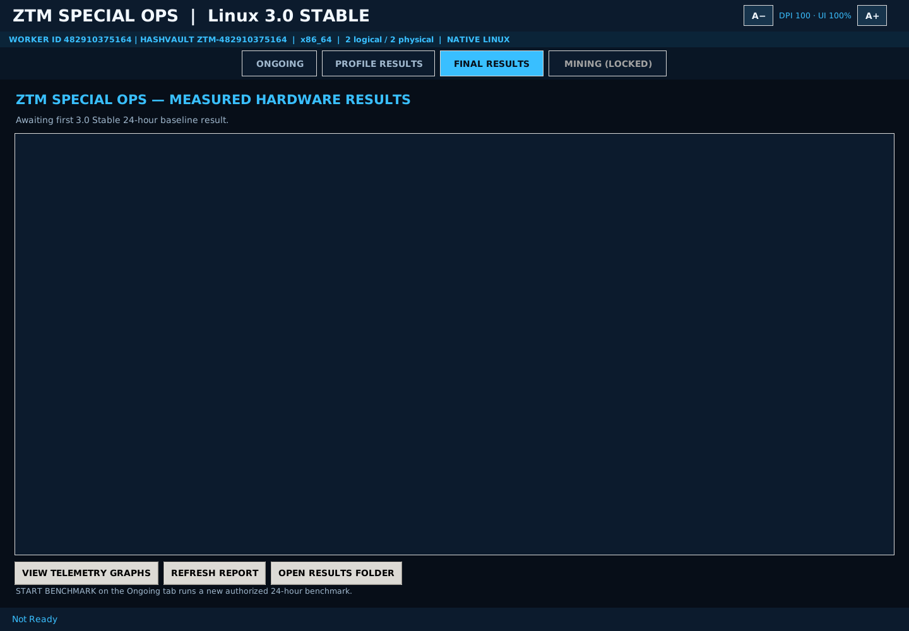
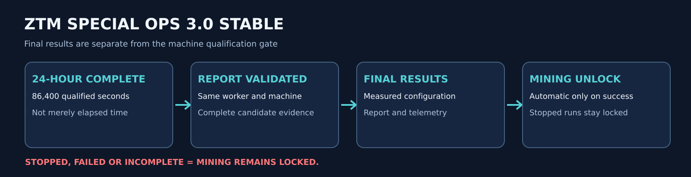

# ZTM Special Ops — 3.1 Stable

> **CURRENT 3.1 RELEASE STATUS — LINUX FIRST (November 1, 2026)**  
> The Linux 3.1 candidate is entering a controlled 24-hour real-machine validation before public release acceptance. Automated and simulated tests are not a substitute for that field test. The Intel macOS and Mac Apple Silicon application release is planned separately; no signed, notarized Mac application is claimed as distributed by this Linux-first stage.

**Different machines. Different capabilities. Same destination.**

ZTM Special Ops is a graphical RandomX/XMRig CPU benchmarking and personal-mining application. A deliberately authorized **24-hour qualified online benchmark** measures a computer's performance, preserves locally recorded telemetry and results, and qualifies that same worker for personal mining only when its report and eligibility checks pass. The **Mining** tab stays locked until qualification; benchmark payouts use the fixed I2PS development receiving address, aside from XMRig's separately administered upstream donation.

## Linux offline bootstrap — distribution candidate (November 1, 2026)

**The previous APT-dependent Linux installer is superseded.** The current prepared archive contains the complete Debian application and a bundled Python 3.13/Tk GUI runtime. Installation and first GUI launch do **not** require a working APT repository or DNS. Dependencies and mining-system preparation are handled as separately authorized steps *after the GUI opens*.

- **Prepared archive:** `ZTM_Special_Ops_3_1_Stable_LINUX_OFFLINE_INSTALL.zip`
- **ZIP SHA-256:** `e139f58c12b2ceb41055ecb81f4154c7c283476b3da3a9f3b5e6806f93a0160b`
- **Debian package build:** `3.1.0+native3offline1` (GUI branding: **3.1 Stable**).
- **Installation command (after download/extraction):** `bash install.sh` as a regular Ubuntu desktop user.
- **Protection:** 29 compiled proprietary Cython modules are byte-identical to the prior 3.1 release candidate; no original private ZTM Python source is shipped. The readable bundled Python standard library is third-party runtime code under its own licenses.
- **Verification:** ZIP integrity, package manifest, offline-runtime/Tk imports, and a local Debian installation plus graphical smoke test passed. **Ubuntu-specific first-launch and 24-hour field qualification are still pending.**

The Linux release ZIP has **not yet been attached to GitHub Releases**. Check the [official Releases page](https://github.com/I2PS-Engineering/ZTM_SpecialOps/releases) once publication occurs. Never use the superseded APT-dependent ZIP. A SHA-256 alone is not proof of publisher identity.

## Current 3.1 platform scope

| Platform | 3.1 engineering behavior | Release state |
|---|---|---|
| Ubuntu Linux x86-64 | Hardware-aware candidate search, XMRig automatic-reference comparison, qualified measurements, CPU affinity screening, statistical selection with A-B-B-A retesting, 24-hour benchmark and Mining tab | Linux release candidate; physical 24-hour qualification pending |
| Intel macOS | Candidate search without Linux-specific CPU pinning, live telemetry and 24-hour benchmark | Native distribution, signing and notarization still pending |
| Mac Apple Silicon | Graphical, beginner-accessible one-click mining workflow with live telemetry; standard XMRig automatic CPU configuration rather than Intel/Linux engine-selection search | Mac app distribution pending; future inclusion in ZTM Vanguard is planned, not implemented |

The eventual macOS application is intended to be signed using the project's Apple Developer ID and notarized by Apple. These are release requirements, **not claims of completed signing/notarization**. No Vanguard telemetry upload or device-integration pipeline is part of this release.

## Mining tab and official wallet link

There is **one unified Mining tab**, not a separate Wallet tab. After same-machine qualification, it provides the public Monero receiving-address field, validation, an [official Monero wallet website](https://www.getmonero.org/) link for users who need to create their own wallet, personal-mining terms, and **START MINING / STOP MINING**. The application does **not** create wallets, manage encrypted wallet files, request private keys, or collect recovery phrases.

## Exactly how the 1% I2PS contribution is scheduled

The 3.1 personal-mining implementation uses **one supervised XMRig process**, with scheduled payout-address reconfiguration, rather than a second hidden miner:

```python
cycle_seconds = 6000         # 100 minutes
i2ps_slot_seconds = 60       # 1 minute
elapsed = monotonic_now - personal_mining_session_start
cycle_position = elapsed % cycle_seconds
use_i2ps_address = cycle_position >= (cycle_seconds - i2ps_slot_seconds)
```

- **From 0 to 5,940 seconds of each complete cycle (99 minutes):** XMRig is configured for the user's public Monero receiving address.
- **From 5,940 to 6,000 seconds (the final minute):** XMRig is configured for the fixed I2PS development receiving address.
- **Every subsequent 6,000-second cycle repeats this pattern**, provided personal mining continues. The I2PS scheduled fraction is **60 / 6,000 = 1% of elapsed personal-mining session time**.
- **Separately:** XMRig's own built-in `donate-level: 1` retains its **independent upstream 1% developer contribution**. It is not the same as the I2PS payout-address interval.

On Linux, a wallet-address change is applied through a validated privileged-session reconfiguration request. If the mandatory contribution switch is rejected, ZTM stops personal mining rather than silently continuing without it. A short session, start/stop timing, connection interruptions, XMRig's independent donation schedule, pool share difficulty and share luck can all affect realized results. **Scheduled time percentages are not guaranteed percentages of accepted shares, rewards, or earnings.** The scheduler uses monotonic elapsed time; this is not a promise of exactly 60 seconds of pool-confirmed work per cycle.

**The benchmark has a different payout rule:** its user-authorized 24-hour measurements direct ordinary pool rewards to the fixed I2PS development address, with XMRig's own upstream donation remaining separate. The personal receiving address is used only in the unlocked Mining workflow.

## Documentation provenance

The material below is the **preserved 3.0 Stable technical reference**, maintained to avoid silently discarding historical mathematical explanations, figures, operating details or prior documentation. It is **not** a statement that 3.0 trial selection, all 3.0 interface text or the 3.0 test counts define the 3.1 candidate. In any conflict, the 3.1 source and the current 3.1 sections above govern the described behavior. Hardware-dependent release acceptance is still pending.

---

## Archived engineering reference — 3.0 Stable (historical)

# ZTM Special Ops — 3.0 Stable

**Built by I2PS Engineering.**


**Different machines. Different capabilities. Same destination.**

A bicycle, a motocross bike, and a sport motorcycle do not have the same engine, gearing, tires, cooling or traction. You would not prepare all three for an uphill journey in exactly the same way. Nor should every processor be told to mine RandomX with the same thread count, initialization budget, memory assumptions and CPU placement.

Consider the mountain as the mining journey. The **engine** is the CPU; preparation is dataset initialization, Huge Pages and supported MSR optimizations; **grip** is the interaction of thread affinity, cache-sharing and memory efficiency; **road conditions** are thermals, power behavior and system contention; **endurance** is sustained, *measured* hashrate. The **slope** represents pool share difficulty (VarDiff): a steeper slope represents a higher-difficulty, rarer accepted share. That does **not** mean raising VarDiff by itself produces more blocks. Greater sustained hashrate increases attempts per second and hence the chance of finding hashes that meet a difficult target. A pool adjusts share difficulty largely to control share-submission frequency.

An old motorcycle may accelerate brilliantly in first gear, then lose speed climbing under heat or load. Likewise, a CPU's initial hashrate spike does not establish its sustained capability. **ZTM Special Ops seeks the best repeatable performance of *that machine***, rather than one impressive peak or a universal configuration. Modest recycled hardware deserves a measured configuration just as much as powerful hardware does.



*Figure 1 — Corrected whiteboard analogy: the bicycle starts the journey, the sport motorcycle follows on the less demanding lower slope, and the **cross/off-road motorcycle tackles the steepest, roughest terrain**. The illustration explains individual optimization, not a guaranteed performance ranking. Higher pool VarDiff means rarer pool shares, **not by itself a higher network block-discovery rate**.*

---

**I2PS Engineering · ZTM Special Ops 3.0 Stable**  
**Platforms:** Ubuntu Desktop x86-64/AMD64 (Intel, AMD Ryzen, Intel hybrid P/E); macOS Intel x86-64 and Apple Silicon arm64 · **Benchmark:** online RandomX through XMRig · **License:** proprietary, free for permitted personal use, **not open source**.

> **About the illustrations and measurements:** Interface layouts and workflow figures show implemented controls and their sequence, not fabricated hashrates or sensor measurements. Historical engineering data is labeled separately. Real benchmark results are machine-specific.

## Contents

1. [Purpose and boundaries](#1-purpose-and-boundaries)
2. [Installation and first launch](#2-installation-and-first-launch)
   - [Hardware and system requirements](#hardware-and-system-requirements)
3. [Workflow at a glance](#3-workflow-at-a-glance)
4. [System preparation — installation safety](#4-system-preparation--installation-safety)
5. [Hardware identification and baseline inventory](#5-hardware-identification-and-baseline-inventory)
6. [Native preparation and verified XMRig](#6-native-preparation-and-verified-xmrig)
   - [Identical starting conditions: Huge Pages and the RandomX dataset](#61-identical-starting-conditions-huge-pages-and-the-randomx-dataset)
7. [Mathematical candidate generation and CPU-affinity search](#7-mathematical-candidate-generation-and-cpu-affinity-search)
   - [Intel x86-64 versus Apple Silicon arm64](#intel-x86-64-versus-apple-silicon-arm64)
8. [24-hour baseline: discovery, sustained winner and qualified time](#8-24-hour-baseline-discovery-sustained-winner-and-qualified-time)
9. [Live GUI: what every screen and measurement means](#9-live-gui-what-every-screen-and-measurement-means)
   - [Six live graphs and clickable event evidence](#six-live-graphs-and-clickable-event-evidence)
   - [VarDiff, share activity, and field evidence](#vardiff-share-activity-and-field-evidence)
   - [Memory Guardian Monitoring](#memory-guardian-monitoring)
   - [Dual-platform rolling GUI memory and JSONL persistence](#dual-platform-rolling-gui-memory-and-jsonl-persistence)
10. [Baseline results and qualification](#10-baseline-results-and-qualification)
11. [Baseline qualification and Mining access](#11-baseline-qualification-and-mining-access)
12. [Unified Mining tab and Monero wallet](#12-unified-mining-tab-and-monero-wallet)
13. [STOP, interruption, rollback and failure handling](#13-stop-interruption-rollback-and-failure-handling)
14. [Data, privacy, rewards and electricity](#14-data-privacy-rewards-and-electricity)
15. [Troubleshooting and measurement evidence](#15-troubleshooting-and-measurement-evidence)
16. [ZTM Vanguard, licensing and further documentation](#16-ztm-vanguard-licensing-and-further-documentation)

## 1. Purpose and boundaries

ZTM Special Ops is a real-machine benchmarking and local optimization application. The program inspects permitted CPU topology and supported memory evidence; prepares an online XMRig environment; measures XMRig's own automatic configuration **twice** (first and last) and up to five physically chosen challenger worker counts; on Linux, pins each challenger to a topology-aware CPU placement and screens only genuinely different placements; keeps XMRig's configuration unless a challenger beats it by more than the run-to-run noise measured on that machine; and devotes the remainder of a **24-hour qualified online session** to sustained validation. **3.0 Stable uses one qualified 24-hour baseline before Mining can unlock.**

Special Ops does **not** emulate the CPU, predict guaranteed profitability, guarantee hardware-safe overclocking, transform old hardware into modern hardware, promise that every sensor is readable, or claim a stronger network block probability merely because pool VarDiff rises. It is also **not** ZTM Vanguard: 3.0 Stable contains no Vanguard remote telemetry/intelligence reporting pipeline. Vanguard is a separate project; any future integration requires separate design and authorization.

For this release, **benchmark workloads mine to a hardcoded I2PS Engineering receiving wallet**, except for **XMRig's independent built-in developer donation**. The user's own receiving address is used only within the separate, unlocked **Mining** workflow. More on that in §14 and [Terms](TERMS.md).

## 2. Installation and first launch

**Product identity:** **ZTM Special Ops 3.0 Stable** is the public application name on Linux, Intel macOS and Apple Silicon macOS. Historical internal protocol identifiers remain embedded in existing report data for compatibility but are not user-facing release names. The benchmark engine records two XMRig automatic-reference trials around hardware-aware challenger profiles and uses measured online evidence to determine the winner. The GUI includes a bounded chart history and one-time event-marker callback registration; the Linux miner uses broker-validated root-private configuration, and Linux personal mining uses a TLS-protected pool connection.

### Hardware and system requirements

| Requirement | Minimum | Recommended | Why |
|---|---|---|---|
| **RAM** | 4 GB | 8 GB or more | RandomX needs about 2.3 GB (the 2,080 MiB dataset and the 256 MiB cache), plus 2 MiB per mining thread, plus about 1 GB for the operating system. With less than about 2.3 GB of total RAM, XMRig switches to RandomX light mode, which is many times slower. A 4 GB machine benchmarks normally but may not receive full huge pages; ZTM reports what it gets. |
| **CPU** | 64-bit x86-64 (Intel or AMD), or Apple Silicon | Hardware AES (Intel since about 2010, AMD since about 2011) and about 2 MiB of L3 cache per mining thread | RandomX uses AES heavily and its speed follows L3 cache. Without hardware AES the machine still benchmarks, more slowly. |
| **Operating system** | Ubuntu Desktop x86-64 22.04 or newer; macOS 11 Big Sur or newer | — | The Linux package requires Python 3.10 or newer; the macOS app declares macOS 11 as its minimum. |
| **Free disk space** | 1 GB | 2 GB | The application and XMRig are small; reports and telemetry grow during a 24-hour run. |
| **Network** | Stable internet connection | Wired | The benchmark mines online; disconnected time does not count toward the 24 hours. |
| **Power** | Mains power with the manufacturer's charger | — | An underpowered charger or a failing battery makes many laptops run at minimum clock speed, and the benchmark then measures the power supply, not the CPU. |
| **Display** | A desktop session | — | ZTM Special Ops is a desktop application. |

### Supported installation model

**3.0 Stable distribution:** Linux ships an AMD64 Debian package with a guarded replacement installer. macOS ships separate native Intel x86-64 and Apple Silicon arm64 paths. The Linux instructions below are Linux-specific; they must not be followed on macOS. The macOS flow is **Run Native Preflight → Prepare macOS + Install XMRig Requirements → Start 24-Hour Benchmark → Final Results**. The preparation control becomes inactive after successful completion. Benchmark START becomes inactive while running, with STOP available. Personal Mining remains locked until a qualifying same-machine 24-hour online benchmark has completed and its results are presented.

3.0 Stable is packaged as a **self-contained application Debian package**, with a guarded installer, checksums, official launcher, supplied app icons and documents. It does **not** include the entire private engineering workspace, does **not** require a source checkout, and does not require the user to compile the program. It is **not an air-gapped/offline install**: Ubuntu APT dependencies and the verified XMRig binary are obtained when required. The program's runtime includes Python modules; its proprietary license is a legal restriction, **not a claim that every implementation detail is cryptographically hidden**.

The package identity is **`ztm-special-ops`**. Its launcher is **`ztm-special-ops`**. It uses separate Special Ops installation and data paths rather than claiming the package name of an earlier ZTM application. The bundled icon is the approved gold ZTM / I2PS Engineering artwork. The figures and UI screenshots included here are documentation assets; their presence in a public repository does not make the application source open source.

### Official release procedure (after release assets are published)

1. Download **the 3.0 Stable distribution ZIP** from the official [ZTM Special Ops Releases](https://github.com/I2PS-Engineering/ZTM_SpecOps/releases) page. Do not assume a final release asset already exists simply because this README exists.
2. Extract the ZIP on **Ubuntu Desktop x86-64**, enter the extracted directory, and confirm that `ZTM-Special-Ops-3.0-Stable_amd64.deb`, `install.sh` and `SHA256SUMS.txt` are present.
3. From a normal user shell in that directory, verify integrity and install:

   ```bash
   sha256sum -c SHA256SUMS.txt
   bash install.sh
   ```

4. Read the installed [Terms](TERMS.md), [License](LICENSE.md) and [Privacy Notice](PRIVACY.md). The installer prompts before invoking Ubuntu package management. It checks the Debian **package name and version**; installation then requests administrative access via `sudo` as needed.
5. Launch **ZTM Special Ops** from the Ubuntu applications menu or run:

   ```bash
   ztm-special-ops
   ```

6. Choose **PREPARE LINUX + INSTALL XMRIG** in the GUI. Accept the separate privileged preparation prompt after reviewing its scope. Next, authorize the 24-hour benchmark using the **single** required checkbox and the confirmation dialog, then select **START BENCHMARK**.

**Never run the provided installer as root.** Do not bypass the SHA-256 verification. Installation can fail cleanly if Ubuntu, architecture, dependencies or package identity do not match, or if a running Special Ops session must first be stopped. A future official release should publish the package SHA-256 through a separately trusted channel as well; a checksum shipped alongside an untrusted archive only checks internal consistency, not publisher authenticity.

### macOS — Intel and Apple Silicon installation and first use

**macOS is a first-class 3.0 Stable target**, with separate native Intel **x86-64** and Apple Silicon **arm64** packaging. Use the macOS distribution and its accompanying verification manifest; **do not use the Ubuntu `.deb`, `apt`, or Linux installer on a Mac**. Confirm the application architecture and required permissions/dependencies in the native preflight before authorizing privileged preparation.

1. Verify the downloaded macOS distribution against its published manifest, extract it, and use the supplied application, **ZTM Special Ops 3.0 Stable.app**. On Intel Macs, a fresh restart with nothing else open gives macOS the most unfragmented memory for the 2 GiB RandomX dataset and the best hashrate (§6.1). It is recommended, not required.
2. Select **Run Native Preflight**. Review CPU architecture, available hardware/memory evidence, operating-system permissions, and the supported XMRig execution path. On Intel Macs it also runs the superpage check (§6.1). Unsupported readings remain marked unavailable.
3. Select **Prepare macOS + Install XMRig Requirements** and review its permission requests. The preparation control becomes inactive after a successful preparation; do not infer Huge Pages or MSR success merely from the UI.
4. Review the benchmark/payout and electricity disclosures, authorize **one 24-hour qualified online baseline**, and press **START BENCHMARK**. During a running benchmark START becomes inactive and **STOP** remains available.
5. Review **Final Results**. The **MINING (LOCKED)** tab unlocks only after the application accepts a complete qualifying result **for the same machine**, and not merely because a test flag or elapsed wall time exists.

**Architecture matters:** Intel Macs use x86-64 CPU topology, logical-CPU/SMT and cache-sharing reasoning where observed; Apple Silicon Macs use arm64 topology, heterogeneous performance/efficiency-core awareness where exposed, and native placement/scheduling constraints. They are not treated as an Intel CPU with the same numerical thread formula. The macOS implementation is kept separate from Linux's CPU-affinity planner; see §7 below.

### Initial GUI and first-launch workflow

The **Ongoing** tab provides preparation, authorization, benchmark execution, live status and STOP. The four tabs are **ONGOING**, **PROFILE RESULTS**, **FINAL RESULTS** and **MINING**; the Mining tab shows **(LOCKED)** until the machine qualifies.



*Figure 2 — Linux Ongoing tab on first launch, before preparation. The header shows the installation's worker ID, its HashVault worker name, architecture and permitted logical/physical CPUs. Preparation checks are PENDING, START BENCHMARK is inactive until preparation succeeds, and MINING is locked. Each worker ID is generated once per installation; the one shown belongs to the capture machine.*

## 3. Workflow at a glance

**System Preparation → 24-Hour Benchmark → Final Results → Mining Unlock.**



**System Preparation** identifies the CPU and memory, checks for conflicting workloads and prepares verified XMRig and supported operating-system settings. Linux and macOS use their respective native preparation paths.

**24-Hour Benchmark** requires one authorization checkbox and a separate confirmation. The measured workflow runs XMRig's automatic reference, hardware-aware challenger configurations, then an identical automatic-reference repeat. It selects the configuration using qualified online evidence and continues with the measured winner for the remainder of **86,400 qualified online seconds**. Explicit CPU-affinity screens and Linux memory PSI boundary observations are Linux-specific; macOS uses native scheduling.

**Final Results** presents the qualification report, measured configurations, winning performance, available telemetry and evidence. The interface includes an independent **FINAL RESULTS** tab; on Linux the report screen provides **OPEN RESULTS FOLDER**, and on macOS **SHOW REPORTS FOLDER PATH**. The **START BENCHMARK** button remains available for subsequent runs when idle and prepared.

**Mining Unlock** occurs **automatically only after a successful, validated 24-hour benchmark for the same machine and worker**. It never unlocks simply because a timer elapsed, the user opened Final Results, or a session was stopped or incomplete. The **MINING** tab remains disabled during an active benchmark. After qualification, users can provide their public wallet address and control personal mining. On macOS the Optimized Performance selection is disabled; Maximum Performance is the available control.



*Figure 3 — Public workflow. The Mining tab is locked until the same-machine 24-hour qualification succeeds.*

## 4. System preparation — installation safety

**Goal:** preserve the operating system, existing personal data and unrelated workloads while establishing a controlled Special Ops installation. System preparation is **not** disk formatting, Ubuntu reinstallation or an indiscriminate `pkill` against unknown programs.

The guarded installer checks Linux/Ubuntu architecture, required installer tools, archive SHA-256, Debian package name and version, and whether a Special Ops session is already active. It asks for user approval, then invokes Ubuntu package management **only for the `ztm-special-ops` package and its declared dependencies**. It does not automatically remove other ZTM variants, wipe their data directories, uninstall arbitrary software, stop GNOME services or kill other users' processes.

**Separate runtime isolation:** before CPU benchmarking, privileged preparation/startup may request a controlled stop of recognized competing **XMRig executables**. The detection path checks the executable basename, process owner and PID/start identity, and re-verifies identity before signaling. The scope of this runtime cleanup must be reviewed on a shared machine: it is broader than merely stopping an instance created by Special Ops, so the user should explicitly know which XMRig workloads they are authorizing it to stop. It never justifies terminating unrelated programs. If safe isolation cannot be confirmed, the workload should fail closed rather than produce contaminated measurements.

What Stage 0 preserves: the user's home files, wallet seed and private keys (never requested), the previous benchmark programs' unrelated installation/data paths, standard Ubuntu services and independent system configurations. Existing *Special Ops* package-managed files can be replaced during a normal package upgrade; personal reports require separate care before uninstall or reinstallation.

## 5. Hardware identification and baseline inventory

**Goal:** obtain machine-specific evidence before selecting workload counts. Hardware discovery is carried out through Linux CPU topology and accessible hardware/system interfaces at application startup and preflight. The stage numbers describe the *logical workflow*: some deeper measurements occur **after the GUI opens, during authorized preparation**, rather than literally before the first GUI window is drawn.

| Source / feature | Used to determine | Important limitations |
|---|---|---|
| CPU model, vendor and architecture | Intel / AMD / Apple vendor (selects the SMT prior), x86-64 support, eligible kernel/features | A model name alone does not predict RandomX throughput |
| Intel hybrid P-core / E-core sets | `/sys/devices/cpu_core/cpus` and `cpu_atom/cpus` on Linux; `hw.perflevel*` on macOS | Absent on non-hybrid CPUs; Apple placement remains under macOS scheduling |
| Physical vs logical cores | Independent core groups, SMT sibling relationships, concurrency bounds | Linux process affinity mask can restrict otherwise present CPUs |
| Allowed CPU IDs | Precisely which logical CPUs the current process may use | Never assume valid CPUs are sequential `0..N-1` |
| L1/L2/L3 cache sizes and sharing | Cache-domain oversubscription prior and placement search | A cache size is a capacity clue, not a measured hashes/second value |
| Memory generation (DDR/LPDDR) | Annotated memory context for the planner | SMBIOS/firmware inventory may be incomplete or inaccurate |
| Memory frequency / advertised timings | Conservative speed priors, diagnostic reporting | SPD rating is **not** verified live controller timing |
| Channel configuration | Bandwidth context **only when verified** | DIMM count or labels do not prove active dual-channel interleaving |
| Measured synthetic bandwidth and latency | Weak proxy signals for memory saturation and contention | They are *not* RandomX-specific bandwidth/latency measurements |
| Available memory and Linux memory pressure | Ability to fit RandomX working set with OS headroom | Swap or competing activity can change behavior mid-run |
| Huge Pages / MSR device | Readiness indicators for optimization | Reserved Huge Pages are **not proof** that XMRig used them |
| Current clocks, sensors, throttle counters | Observability for benchmark stability, thermal safety and the reference-bracket thermal-drift check | Unsupported sensors stay **unavailable**; no made-up values. AMD `k10temp`: Tdie, then the hottest Tccd, then Tctl (Tctl may carry a fan-control offset). AMD has no Linux throttle counter, so a sustained clock sag of ≥10% within a profile is reported as a throttle *proxy* |

On Linux, sysfs and `/proc` provide much of this information. The project uses actual `sched_getaffinity`-permitted CPU IDs, shared L2/L3 groups, SMT siblings and, when available, NUMA groups. Missing inputs are recorded as unknown, not silently inferred as ideal hardware.

RandomX's memory-aware heuristic reserves context for a dataset of approximately **2,080 MiB**, a **256 MiB cache**, about **2 MiB scratchpad per active worker**, and **1,024 MiB OS headroom** in its *planning feasibility check*. These are model constants/assumptions, not measured peak memory consumption or universal guarantees. Available RAM can rule out unrealistic configurations; memory-controller bottlenecks then influence their prior ranking.

## 6. Native preparation and verified XMRig

**Goal:** establish repeatable test conditions before the first timed trial.

Inside the GUI, **PREPARE LINUX + INSTALL XMRIG** runs a sequenced preparation workflow. The package declares `python3`, `python3-tk`, `pkexec`, `apt`, `ca-certificates`, `kmod` and `msr-tools` as system dependencies; installation can request additional Ubuntu packages through APT. Preparation refreshes relevant APT metadata and installs missing prerequisites without performing an indiscriminate full-system upgrade.

This 3.0 Stable build requests a **version-pinned, SHA-256-verified XMRig 6.26.0** from its configured official distribution source. "Verified" means the retrieved artifact matches the expected checksum. **It does not mean that 6.26.0 is necessarily the newest upstream release at the date you read this**. Updating XMRig requires a separately reviewed, pinned release and regression test, never silently downloading an arbitrary unverified "latest" binary.

The preparation path then checks that XMRig can be invoked and that the supported Linux environment can provide the prerequisites for useful RandomX execution. It attempts Huge Pages preparation and relevant MSR support through limited, authorized privileged actions. Its status output distinguishes **attempted**, **available**, **verified**, **not supported** and **failed**. Actual Huge Pages use and MSR effectiveness must be confirmed from XMRig/runtime evidence rather than assumed from a successful install step. ZTM reads that evidence from XMRig's RandomX dataset line and reports it; it never stops a benchmark over it (§6.1).

**Privileged miner configuration (this release):** XMRig runs as root on Linux so it can apply MSR presets. The session broker never lets that root process read a file the desktop user can edit.
- The broker reads ZTM's configuration request once, validates it against a strict allow-list, and writes a canonical copy into a root-owned `0700` directory; root XMRig reads only that copy.
- The allow-list contains one pool, a public Monero address, permitted CPU IDs, and Huge Pages/MSR as on/off switches only.
- Rejected: custom MSR register lists, log-file paths, the HTTP API and unknown keys.
- Benchmark trials disable live reload. Personal mining changes its configuration (for the scheduled I2PS contribution interval) only through a validated broker request. If that request is refused, personal mining stops rather than skipping the contribution.

### 6.1 Identical starting conditions: Huge Pages and the RandomX dataset

A comparison only means something if every configuration starts from the same memory conditions. RandomX hashes read a 2 GiB dataset, and whether that dataset sits on 2 MiB pages changes the hashrate. Special Ops therefore treats the dataset's page coverage as part of the experiment, not as a detail.

- **The RandomX dataset line is the evidence.** XMRig reports huge pages in two places. Its `allocated 2336 MB (2080+256) huge pages X% N/1168` line covers the dataset and cache that every hash reads; the `READY threads … huge pages 8/8` line covers only the small per-thread scratchpads and does not confirm huge pages by itself. Huge pages count as applied only when all 1,168 pages are backed.
- **Every machine benchmarks.** Huge pages are measured and reported, never a reason to stop. Old or modest hardware, such as a machine with 4 GB of RAM or a fragmented Mac, benchmarks with whatever allocation it receives, and its trials are compared with each other on those equal terms. Bringing such machines back into service is the purpose of the project.
- **Linux: the winner is chosen on equal terms.** For security, Linux starts a fresh root XMRig for each trial and affinity screen, including any recovery restart inside a trial. Every start is compared with the reference's dataset page count and MSR result, and a trial is judged by its worst start. A segment that differs is still measured, recorded and counted toward the 24 hours, but it cannot be chosen as winner. The run continues. The report lists every segment under `equal_conditions`, and every start within a trial under `huge_pages_dataset_launches`.
- **Linux: no separate huge-page probe.** Running as root, XMRig reserves huge pages itself at every start, and ZTM reads the actual result from XMRig's dataset line at each start.
- **macOS: one XMRig for the whole benchmark.** The dataset is allocated once; each profile change reloads only the worker count (`cpu.rx`) in the running XMRig, so every trial shares the same allocation, full, partial or none. If XMRig exits or allocates the dataset again, the benchmark ends rather than mixing two allocations, and keeps everything measured up to that point.
- **Intel Mac superpage measurement.** macOS grants 2 MiB superpages only from unfragmented memory, and free memory is no guide: a Mac can report most of its RAM free and still grant a single 256 MiB region. **Run Native Preflight**, and the benchmark again just before XMRig starts, asks macOS for exactly what XMRig will request (one 2,080 MiB dataset region and one 256 MiB cache region of superpages, held together), touches every page, then releases them, and reports the result. If both do not fit, it shows the largest region available and suggests a restart for a higher hashrate. It never blocks.
- **Apple Silicon:** XMRig has no superpages there and uses normal pages on every trial, so conditions are equal by construction.

**On Linux, the 24-hour timer does not start merely because preparation succeeded.** The user must check **"I authorize the 24-hour benchmark"**, review the associated payout/power confirmation and deliberately press **START BENCHMARK**. During the test, only qualified online measurement intervals contribute to the required 86,400 seconds; preparation and startup overhead are separate.

## 7. Mathematical candidate generation and CPU-affinity search

This is the center of Special Ops. It is a **two-layer method**, deliberately keeping *theory* separate from *evidence*:

1. **Prior / candidate model:** rank plausible thread counts and CPU placements from measured or explicitly qualified hardware properties.
2. **Online measurement:** actually run each candidate against the pool, reject incomplete/unstable profiles, compare measured sustained performance, and choose a defensible winner.

The equations and source-aligned definitions below are the mathematical reference for 3.0 Stable. Earlier schematic artwork with illustrative parameters is deliberately omitted to prevent its numbers from being mistaken for the implemented planner.

### 7.1 Physical cores, SMT and legal CPU sets

Let:

- `L` = count of **allowed logical CPU IDs**;
- `P` = count of distinct **physical core groups** exposed to the process;
- `B` = active mining workers chosen by XMRig's automatic baseline;
- `n` = candidate active mining workers (`1 ≤ n ≤ L`);
- `A` = chosen **affinity set**, a legal subset of allowed CPU IDs of size `n`;
- `I` = **dataset initialization thread count**, which is a separate control from `n`.

A mining worker placed on a logical CPU that shares a physical core with another mining worker can face SMT resource contention; multiple workers can also share a finite L2/L3 cache domain. Hardware topology matters, not just the CPU label printed on the chassis.

The implementation uses the **reference-bracket** planner (reference-bracket count planning). A plan has **at most `min(7, L + 1)` full configurations**: the XMRig reference first, up to five challenger worker counts, and an **identical repeat of the reference last**. Machines with few meaningful options get fewer trials rather than invented ones. A 4-thread laptop with 2 physical cores plans 5 configurations; a 4-core/4-thread CPU plans 4.

### 7.2 Init threads are *not* mining threads

**Initialization threads** build the 2 GiB RandomX dataset before XMRig reports READY. **Active threads** perform the ongoing hash computations. Measurement starts only after READY, so the initializer changes **startup time, not steady-state hashrate**. The historical i7 data in §7.6 shows this: two runs with the same 2 active workers and different initializers (2 vs 3) measured 1,057.4 and 1,045.0 H/s, a 1.2% difference within run-to-run noise.

The implementation therefore:

- holds the initializer **constant for the whole campaign**:

$$
I=\min\big(L,\;I_{mem}\big),\qquad I_{mem}=\begin{cases}\lceil P/2\rceil & \text{if measured copy bandwidth}<3\ \text{GB/s or available RAM}<2{,}336+1{,}024\ \text{MiB}\\ P & \text{otherwise}\end{cases}
$$

- compares configurations only by **active workers and placement**;
- replaces the former `(I = P + 1, n = P)` "initializer experiment" with an explicit **repeat of the XMRig reference** at the end of discovery, whose difference from the first run measures the machine's real noise (§7.6a).

Each configuration still starts a fresh supervised miner, and its actual active count is verified from the XMRig log.

### 7.3 Which worker counts are tested (hardware-aware anchors)

Candidate counts come from physically meaningful **anchors**, each recorded with its reason in the report:

$$
\mathcal{A}=\langle\,B{+}1,\;P,\;C_3,\;C_3{+}1,\;B{-}1,\;B{+}2,\;[P_p,\;P_p{+}\lceil P_e/2\rceil,\;P_p{+}P_e]_{\text{hybrid}},\;L,\;C_2,\;P{+}1,\;B{-}2,\;B{+}3\,\rangle
$$

where:
- $C_3=\sum_d\lfloor S_d/2\,\text{MiB}\rfloor$ over L3 domains and $C_2=\sum_d\lfloor S_d/256\,\text{KiB}\rfloor$ over L2 domains, both capped at $L$;
- $P_p$ and $P_e$ are the performance- and efficiency-core counts.

The 2 MiB / 256 KiB / 16 KiB per-worker budgets are **RandomX's own L3 / L2 / L1 scratchpad sizes**.

**Selection rules:**
- Counts outside $1..L$ and $B$ itself are dropped.
- On CPUs with **four or more physical cores**, counts below $f=\max(2,\lceil B/2\rceil)$ are never tested. The performance-cores-only anchor is exempt when $P_p\ge2$.
- $B{+}1$, $P$ and $C_3$ are mandatory when present.
- Remaining slots are filled by the placement prior below (Linux) or by anchor order (macOS).
- If anchors run out, the nearest counts to $B$ (above first) are used. The floor is never relaxed.

### 7.3a Placement prior (Linux)

For each legal CPU set $A$ of size $n$ (lower is preferred; a dimensionless prior, not a hashrate prediction):

$$
J(A)=2P_{L3}+0.6P_{L2}+0.35P_{L1}+1.3\,\varphi\,\frac{S(A)}{P}+E(A)+P_{mem}(A)+0.12\frac{|n-B|}{L}-0.12\frac{n}{L}+P_{L1,fallback}
$$

- $P_{Lk}=\sum_d \max(0,a_d-c_d)/c_d$ with $c_d=\max(1,\lfloor C_d/R_k\rfloor)$.
- $S(A)$ counts extra workers on already-used SMT siblings.
- **$\varphi$ is the vendor SMT factor**: Intel 1.0, AMD 0.25, unknown 0.6. Zen cores have larger private L2 and large L3 slices, so a second RandomX worker per core usually adds throughput; the cache terms already capture capacity.
- **$E(A)=0.5\cdot\min(e_{sel},p_{idle})/n$** on Intel hybrid CPUs penalises using an efficiency core while a performance core is still idle. Together with the SMT term, the order becomes P-core primaries → E-cores → P-core SMT siblings.

The coefficients (`implemented placement heuristic`) are engineering priors. **The measured online median decides.**

### 7.4 How RAM enters the mathematics ($P_{mem}$, exact terms)

With $n$ workers, $S$ extra SMT siblings, $P$ physical cores and $o=\max(0,n-P)$:

| Term | Applied when | Formula |
|---|---|---|
| Capacity | available RAM $M$ is measured | $M<M_{min}=2{,}336+2n+1{,}024$ MiB: $\;1.8+\min\!\big(4,\tfrac{M_{min}-M}{1024}\big)\big(0.3+\tfrac{n}{P}\big)$, else 0 |
| Bandwidth proxy | synthetic copy bandwidth $W$ (GB/s) is measured | $0.70\cdot\min\!\big(3,\tfrac{\max(0,\,n-c)}{c}\big)$, $\;c=\max(1,W/2)$ |
| Bandwidth × SMT | $W$ measured | $0.18\cdot\tfrac{S}{P}\cdot\min\!\big(2,\tfrac{\max(0,\,8-W)}{6}\big)$ |
| Latency proxy | pointer-chase latency $\lambda$ (ns) measured | $0.35\cdot\min\!\big(2,\max(0,\tfrac{\lambda-95}{95})\big)\cdot\big(\tfrac{o}{P}+0.2\tfrac{n}{P}\big)$ |
| DDR speed prior | configured (confidence 1) or rated (confidence 0.25) MT/s | $0.08\cdot\text{conf}\cdot\operatorname{clamp}(3200/\text{MT/s},\,0.25,\,2)\cdot\tfrac{o}{P}$ |
| Verified channels | channel count from a verified source only | $0.20\cdot\tfrac{\max(0,\,n-T/4)}{\max(1,\,T/4)}$, $\;T=\text{MT/s}\times8\times\text{channels}/1000$ |
| Memory pressure | Linux PSI some avg10 $>2\%$ | $0.40\cdot\min\!\big(3,\tfrac{\text{PSI}-2}{10}\big)\cdot\tfrac{n}{P}$ |
| Huge Pages shortfall | free Huge Pages $<2{,}336+2n$ MiB | $0.04\cdot\tfrac{n}{P}$ |

A term whose input is unavailable contributes **nothing**; it is never replaced by an assumed value. The synthetic bandwidth and latency come from a short native memory-copy and pointer-chase probe run before discovery while no miner is active. They are proxies, not RandomX measurements. Channel hints and nominal memory ratings are never treated as verified live measurements.

### 7.5 CPU affinity: screen only placements that differ

Within the legal CPU mask, the placement planner prefers physical-core-first, same-cache locality or NUMA-aware ordering. On hybrid CPUs it prefers P-core primaries, then E-cores. Small CPU sets are enumerated; larger ones use bounded deterministic candidates.

Each placement has a **topology signature**: workers per core (with P/E class), plus occupancy of every L2, L3 and NUMA domain. Placements with equal signatures are physically equivalent, and measuring them against each other only measures noise.

For each challenger, up to **three topologically distinct** placements whose prior is within **0.30** of the best are screened for **90 qualified online seconds each**.
- The topology-preferred placement is kept within a **2% decision margin**, an engineering rule rather than a confidence interval.
- If only one distinct near-best placement exists, it is used directly without a screen. This is the usual case on single-L3 Intel desktops; AMD SMT spread-versus-pair choices and multi-CCD or hybrid layouts do get screened.

**How every miner launch and screen is checked (Linux):**

1. **Isolation.** The previous supervised XMRig must confirm exit within 25 seconds. The privileged broker then scans for any remaining XMRig, waits a **30-second gap**, and scans again; a miner that reappears stops the run. ZTM never terminates miners it does not own.
2. **Memory boundary.** Before every launch, the Memory Guardian checks available RAM, PSI and swap-out activity, looking for **2 consecutive clear samples at 5-second intervals within a 40-second budget** (§9).
3. **Placement.** The chosen CPU IDs are written to XMRig's `cpu.rx` array. Every ID must be distinct and inside the process's permitted CPU mask.
4. **READY confirmation.** XMRig must report `READY threads n/n` with exactly the requested worker count within **180 seconds**. A requested setting alone never counts.
5. **Warm-up.** $\min(25\,\text{s},\,\text{duration}/5)$ is excluded, so 18 s for a 90-second screen and 25 s for a full trial.
6. **Qualified time only.** Seconds count only while the pool is live and a new pool job arrived within the last **120 seconds**. Offline time pauses the clock. A profile is abandoned after **1,800 s** continuously offline or **12** guarded miner restarts.
7. **Statistic.** The median of XMRig's 10-second hashrate readings, dropping the first reading when at least four exist, with $\mathrm{CV}$ from the same readings.
8. **Count check.** The observed active-worker count must equal the plan; otherwise the trial cannot qualify.

Each configuration then receives **one full 600-second online-qualified trial** under the same checks. Failed screens or incomplete trials are never converted into measurements.

### 7.6a Measuring the noise and choosing the winner (reference-bracket decision)

The XMRig reference is measured **first and last**, bracketing all challengers. Its two medians give the machine's real run-to-run noise:

$$
g=\frac{|H_{rep}-H_{ref}|}{(H_{ref}+H_{rep})/2},\qquad \hat\sigma=g\,\frac{\sqrt{\pi}}{2},\qquad \delta=\operatorname{clamp}\!\Big(2\sqrt{\tfrac32}\,\hat\sigma,\;1\%,\;10\%\Big)
$$

- $\hat\sigma$ uses $E|X_1-X_2|=2\sigma/\sqrt\pi$ for two independent trials.
- $\sqrt{3/2}$ accounts for comparing one challenger against the mean of two reference runs.
- A missing repeat gives $\delta=3\%$. An unclamped $\delta>10\%$ is reported as `bracket_unstable`.

**Per-trial quality** is $Q=\tilde H\cdot\max(0.70,\,1-\min(\mathrm{CV},0.30))$. **Pool shares are a gate, not a multiplier.** In a 600-second trial a worker typically submits only about a dozen shares, so one stale share used to move the old acceptance factor by about 8%. Now a trial can be disqualified only when it has **at least 30 shares and more than 5% rejected**.

**Thermal drift:** the CPU may have slowed between the two reference runs, shown by any of: median clock −3% or more, median temperature +5 °C or more, OS throttle counters increasing, or macOS thermal pressure serious or critical. If so, each median is corrected for its position in time, $\tilde H_i=H_i/(1+d\,\tau_i)$, with $d=H_{rep}/H_{ref}-1$ and $\tau_i\in[0,1]$ the trial's fractional position between the two reference runs. Without such evidence, no correction is applied: the gap counts as noise and widens $\delta$.

**Decision:** the best eligible challenger wins only if $Q_{c^*}>\bar Q_{ref}\,(1+\delta)$, where $\bar Q_{ref}$ is the mean of the two reference runs. Otherwise **XMRig's own configuration is kept**, and the sustained run uses it exactly as measured. Every intermediate value is saved in the report as the recorded winner-decision fields.

### 7.6 Actual older-machine engineering example

In an earlier **physical engineering experiment** (not a 24-hour qualification), an **Intel Core i7-6600U notebook** had **2 physical cores, 4 logical CPUs, 4 MiB shared L3**, and DDR4-2133 RAM. The run's hardware inventory and XMRig logs underlie the following recorded full-trial medians:

| Configuration | Dataset init (`I`) | Active (`n`) | Measured trial median |
|---|---:|---:|---:|
| XMRig automatic reference | 2 | 2 | **1,057.4 H/s** |
| Mathematical candidate | 2 | 1 | 634.0 H/s |
| Mathematical candidate | 4 | 3 | 980.1 H/s |
| Mathematical candidate | 5 | 4 | 947.1 H/s |
| Physical-core extra-init experiment | 3 | 2 | 1,045.0 H/s |

**Interpretation:** Extra active threads did *not* automatically increase useful throughput. The two 2-active runs that differ only in initializer (1,057.4 vs 1,045.0 H/s) are the evidence that the initializer does not set steady-state hashrate (§7.2); under reference-bracket they would be read as a ~1.2% noise bracket, so no challenger here wins. The automatic **2-init/2-active** reference performed best among these five measured configurations. A separate, earlier-protocol **60-minute physical winner validation** recorded a sustained median of approximately **1,038.7 H/s**, with **120 accepted** and **0 rejected** shares. This validates that the old notebook could sustain that configuration during that **hour**, **not** that 3.0 Stable's new 24-hour protocol has been completed on it. These figures must not be mislabelled as live 3.0 Stable GUI data.



*Figure 4 — Historical i7 experiment, recorded before the current 3.0 Stable protocol. It is not a current GUI screenshot, six-chart example, or completed 24-hour report.*

### Intel x86-64 versus Apple Silicon arm64

**There is no single universal 'best number of threads.'** Special Ops evaluates candidate configurations based on what each processor and operating system can actually expose and execute. The hardware-aware count anchors (§7.3) and the decision rule (§7.6a) are **shared by Linux and macOS** (the same count-planning algorithm is used on both). The placement prior and affinity screens (§§7.3a, 7.5) are **Linux-only**, because macOS has no supported CPU-pinning interface.

| Consideration | Linux x86-64 / Intel-style topology | macOS Intel x86-64 | macOS Apple Silicon arm64 |
|---|---|---|---|
| CPU topology | Allowed logical CPU IDs; physical core groups; SMT siblings; shared cache / NUMA where available | Intel core, logical-thread/SMT and shared-cache evidence, subject to macOS exposure | Heterogeneous performance (**P**) / efficiency (**E**) cores where detected; native arm64 scheduling |
| Candidate active workers | Bounded by allowed logical CPUs and mathematical/cache/memory feasibility | Bounded by available native processor resources and observed trial results | Must account for unlike P/E cores, execution capacity and scheduling; do not assume all cores perform equally |
| Initializer workers | Constant per campaign, capped at `L` | Constant per campaign | Constant per campaign |
| Affinity / placement | Legal explicit Linux CPU masks, deterministic topology-aware screening | Placement decisions only as supported by native macOS interfaces | Scheduling/QoS and P/E-aware decisions only where actually supported; no fabricated Linux-style pinning |
| Cache / memory | L1/L2/L3 sharing, DDR evidence, Huge Pages/MSR readiness and memory pressure | Available Intel cache, memory and native performance evidence | Apple Silicon cache topology, unified-memory availability/pressure and native capabilities; never assume Intel MSR or Linux Huge Pages |
| Winner | reference-bracket decision: beat the twice-measured XMRig reference by more than the measured noise floor | Same reference-bracket decision | Same reference-bracket decision |

The architectural model is an **engineering prior**: core class, cache sharing, active-thread saturation, dataset preparation, memory capacity/latency, contention, thermal stability and actual online hashrate all matter. A feasible active-thread count is not automatically optimal, and a higher initialization-thread count does not imply more steady-state mining workers. The winning setting must be selected from **observed, qualified XMRig trials** rather than a claimed universal rule.

**Mathematics versus observation:** The placement prior applies only to Linux. On Intel macOS and Apple Silicon, the count anchors and the decision rule are the same code as on Linux, while placement is left to macOS. The table distinguishes native platform behavior and does not imply CPU pinning on macOS. An unavailable P/E mapping, memory sensor, clock or affinity control must be recorded as unknown/unsupported rather than inferred.

### Linux, Intel macOS and Apple Silicon: exact candidate selection

**One qualification workflow, one shared count planner.** Linux and macOS both use the hardware-aware anchors (§7.3) and the reference-bracket decision (§7.6a). Linux additionally pins challengers using the placement prior and screens distinct placements. macOS runs **count-only** experiments under native scheduling, with no CPU pinning, affinity screens or Linux 2% margin.

#### macOS candidate-generation mathematics

With `L` logical CPUs, `P` physical cores, `B` the verified XMRig automatic count, and (on Apple Silicon) `p` performance and `e` efficiency cores:

1. **Reference:** `n = B`, run first.
2. **Challengers:** the hardware-aware anchors. Apple Silicon adds `p` (performance cores only, kept even below the tiny-count floor when `p ≥ 2`), `p + ⌈e/2⌉` and `p + e`. Intel Macs use the L3 capacity anchor from `hw.l3cachesize`. Counts below `max(2, ⌈B/2⌉)` are skipped when `P ≥ 4`.
3. **Repeat of the reference** last, identical to step 1.
4. One constant initializer for every configuration.
5. **No explicit Mac affinity screen:** every entry records `affinity_status = not_supported_on_macOS`. A count does not guarantee P- or E-core placement.

Example plans (worker counts in order, reference in bold, XMRig automatic `B` assumed):

| Machine | Plan |
|---|---|
| Apple M4 (4P + 6E), B = 10 | **10** → 9 → 4 → 7 → 8 → 6 → **10** |
| Apple M4 Max (12P + 4E), B = 16 | **16** → 15 → 12 → 14 → 13 → 11 → **16** |
| Intel i9 MacBook Pro (8C/16T, 16 MB L3), B = 8 | **8** → 9 → 7 → 10 → 16 → 6 → **8** |

Linux examples:

| Machine | Plan |
|---|---|
| Intel i9-9900K (8C/16T, 16 MB L3), B = 8 | **8** → 9 → 7 → 6 → 10 → 11 → **8** |
| AMD Ryzen 7 5800X (8C/16T, 32 MB L3), B = 16 | **16** → 8 → 9 → 14 → 15 → 13 → **16** |
| Intel i5-8500 (6C/6T, 9 MB L3), B = 4 | **4** → 5 → 6 → 3 → 2 → **4** |

#### Scoring and qualified time

Both platforms score each trial as `Q = H̃ × max(0.70, 1 − min(CV, 0.30))`, use pool shares only as the ≥30-share / >5%-rejected gate, and apply the reference-bracket decision. **Each full candidate trial targets 600 qualified online seconds.** The 24-hour completion target is **86,400 qualified online seconds**. macOS also imposes a **36-hour wall-clock ceiling**, and disconnected or unverified time is never counted as qualified.

| Actual behavior | Linux x86-64 | macOS Intel x86-64 | macOS Apple Silicon arm64 |
|---|---|---|---|
| Candidate counts | hardware-aware anchors, vendor- and hybrid-aware | hardware-aware anchors (L3 capacity from sysctl) | hardware-aware anchors with P/E anchors |
| Placement | Linux placement prior; P primaries → E → SMT siblings; vendor SMT factor | Native macOS scheduler | Native macOS scheduler |
| Explicit affinity screening | Only between topologically distinct near-best placements | **Not supported** | **Not supported** |
| Reference measured twice | Yes (first and last) | Yes | Yes |
| Full candidate trials | 600 qualified online seconds each | 600 qualified online seconds each | 600 qualified online seconds each |
| Winner selection | reference-bracket noise-floor decision | reference-bracket noise-floor decision | reference-bracket noise-floor decision |

**Architecture boundaries:** Apple Silicon uses arm64 and unified memory; Intel and Linux x86-64 hardware may expose SMT and different cache topology. Linux-specific MSR, Huge Pages, PSI and affinity evidence must not be assigned to the Mac runtime without native supporting observations. Unavailable native measurements remain unavailable, rather than being filled with theoretical values.



*The two reference measurements bracket challenger evaluation before winner selection. This entire sequence is inside one 24-hour qualified-online benchmark.*

## 8. 24-hour baseline: discovery, sustained winner and qualified time

The first stage targets **86,400 qualified online mining seconds (24 hours)**, not 24 hours of installation plus setup, and not 24 hours of repeating every configuration. The common stages are shown below; **explicit affinity screening and its time budget are Linux-specific**. On macOS the baseline proceeds from unique thread-count trials to the sustained winner without affinity screens. The real sequence is:

1. Confirm user authorization and an available, nonconflicting workload lock. Prepare/check XMRig, pool identity, hardcoded I2PS payout and miner readiness.
2. Launch the **XMRig automatic reference** probe to detect its real active-worker count `B`, and check its RandomX dataset allocation (§6.1).
3. Generate the reference-bracket plan: reference, anchor challengers, final reference repeat. Generate placement candidates **on Linux only**.
4. **On Linux only**, screen topologically distinct placements where they exist. On all platforms, run **one 600-second qualified full trial** per planned configuration, ending with the reference repeat.
5. Apply the reference-bracket decision (§7.6a): noise floor from the reference bracket, optional thermal-drift correction, share gate, noise-floor margin. Reject missing or invalid thread counts, failed pool verification or incomplete measurements.
6. Restart the winner with its **observed** active worker count and placement (XMRig's own placement when the reference is kept), and run it for **the remainder** of the 86,400-second online-qualified budget.
7. Persist reports, measurements and classification. The completion gate checks the exact planned configurations, any required Linux affinity trials and a sufficiently long sustained-winner segment.

If `T_full` is the sum of qualified full trial seconds and `T_aff` the sum of qualified **Linux-only** short affinity-screen seconds (zero on macOS), the sustained-winner target is:

$$
T_{winner}=86{,}400-T_{full}-T_{aff}.
$$

For the earlier 2-core/4-thread example, **five 600-second full trials** (reference, three challengers, reference repeat) total **3,000 seconds**. Affinity screens add separately, depending on how many distinct legal candidate placements qualify. The winning configuration consumes all **remaining qualified time**, not a bolted-on 60-minute run. Network disconnections, pool readiness delays and recovery overhead can make real elapsed wall time longer. The command line also has a protective wall-time ceiling; reaching that ceiling without all qualified seconds yields an incomplete report, not a false completion.

**What is measured:** XMRig hashrate samples (median/mean/min/max where present), observed threads, accepted/rejected shares, pool connectivity and any share-difficulty evidence present in the underlying miner/pool logs, CPU clock/temperature observations where sensors exist, performance stability and any available throttling evidence. **Pool share difficulty is not a CPU benchmark score by itself**. See §9 for the actual GUI presentation.

## 9. Live GUI: what every screen and measurement means

The screenshots in this section are captures of the Linux application in its initial state, before preparation, with no benchmark running. Charts fill only from real sensor and miner observations; nothing is simulated. macOS uses the same four tabs and six charts, with the macOS-specific differences listed in §9.2.

### 9.1 Ongoing — preparation, authorization and live status

The Ongoing tab is shown in Figure 2 (§2).

- **PREPARE LINUX + INSTALL XMRIG:** runs the preparation sequence shown under **PREPARATION CHECKS**:
  1. verify no conflicting XMRig processes;
  2. APT refresh;
  3. install prerequisites;
  4. attempt Huge Pages (confirmed later from XMRig);
  5. load MSR support (confirmed later from XMRig);
  6. read RAM and cache from privileged firmware/sysfs;
  7. measure idle memory-copy bandwidth and pointer latency;
  8. install the official SHA-256-verified XMRig.

  Each step moves from PENDING to PASS or FAILED.
- **I authorize the 24-hour benchmark:** the single authorization checkbox. The confirmation dialog and Terms state the I2PS payout, the XMRig upstream donation, and the CPU load, heat and electricity involved.
- **START BENCHMARK / STOP:** START BENCHMARK becomes available after successful preparation and authorization, and is inactive while a benchmark runs. STOP stays available throughout and cancels without freezing the interface. After a qualified run, START BENCHMARK remains available for a new run; the results appear in the separate FINAL RESULTS tab.
- **Live status block:** current H/s, then `Profile n/N | Active | Init | elapsed / target`, then accepted/rejected shares. `—` means no validated reading yet.
- **PREPARATION TERMINAL / LIVE EVENTS:** preparation output, XMRig log lines with the wallet masked, pool status and errors.
- **LIVE HARDWARE TELEMETRY:** CPU temperature, clock, thermal throttle counters, current profile, and RAM/cache inventory. Anything the hardware does not expose reads **unavailable**.
- **Footer status:** for example *Not Ready*, *Benchmarking in progress.*, or the outcome of the last step.
- **Version check:** triple-click the window title to show the installed version and an 8-character code fingerprint; triple-click again to restore the title. Identical code shows the same fingerprint on every machine.

### 9.2 Profile Results — six live charts, event evidence and measured results



*Figure 5 — Linux Profile Results tab with no benchmark running. CPU usage and system RAM already show the capture machine's own idle readings; temperature, hashrate, VarDiff and shares read AWAITING LIVE MEASUREMENTS because no sensor or miner data exists yet. The measured-results table is empty until trials complete.*

The tab contains, from top to bottom:
- **OPEN EVENT INSPECTOR:** a separate window listing every recorded event; clicking a chart marker opens it on that event.
- **Six charts**, on one common rolling 15-minute time axis;
- **SELECTED EVENT** panel;
- **MEASURED RESULTS — FULL CONFIGURATIONS AND AFFINITY SCREENING:** columns TRIAL, ACTIVE/INIT, MEDIAN H/s, SHARES A/R, CLOCK MHz, MAX °C, THROTTLE, filled as each full trial or affinity screen completes.

| Row | Left chart | Right chart |
|---|---|---|
| 1 | **CPU Temperature Trend:** orange, system sensor, °C | **CPU Usage Trend:** yellow, system-wide `/proc/stat`, % |
| 2 | **RAM Usage Trend:** red, Linux system RAM in GiB (`MemTotal − MemAvailable`) | **Hashrate Trend:** green, pool-connected XMRig H/s |
| 3 | **Pool VarDiff Trend:** violet, normal-pool job difficulty; developer donation shown as a green band | **Share Activity:** accepted green and rejected red, on **one shared count axis** |

All six charts share one clock with ticks `-15m · -10m · -5m · 0m`. Each profile start after the first draws a line on all six charts at the same instant. The Hashrate title carries **HUGE PAGES XX%** from XMRig's dataset line, with the exact pages when incomplete (for example `HUGE PAGES 11% (128/1168)`), and a green trophy while the sustained winner is being measured. Cumulative share totals stay flat between share events; no share is invented.

Each chart shows NOW / PEAK / AVERAGE (or CURRENT / PEAK / AVERAGE) for its window, plus a status line such as *ACTUAL OBSERVATIONS • NOT ESTIMATES* or *AWAITING MEASURED DATA*. An unsupported sensor or missing pool evidence is **not plotted as zero**.

The Hashrate axis starts at zero with round steps, so normal sample noise of a few percent stays small and a real drop still stands out.
When no measurements are available, the GUI leaves the numeric measurement axis unlabeled rather than displaying an artificial 0–1 scale.

**Bands drawn on the charts:**
- **Hashrate chart:** the gap between one trial's completion and the next trial's start is shaded **blue, labelled PROFILE TRANSITION**, or **green, labelled CPU AFFINITY ADJUSTMENT** when the next phase is an affinity screen. The labels are vertical.
- **VarDiff chart:** verified XMRig developer-donation intervals are shaded **green, labelled XMRIG DEV DONATE**. Donation-pool difficulty never enters the normal-pool axis.

**Event markers:** every chart carries the same event ledger as small triangles along its top edge:
- **red** for warning events (rejected share, pool disconnected, Memory Guardian observation, sharp same-pool VarDiff drop);
- **violet** for other events;
- **yellow** for the selected event, which also draws a dashed vertical line.

Markers closer together than a few pixels are grouped, with a count beside the triangle. Clicking a marker fills the SELECTED EVENT panel and opens the Event Inspector. That shows the UTC timestamp, event type, source, phase, and evidence fields such as pool, difficulty, share counts, reason and the raw log excerpt.

**macOS differences:**
- The RAM chart shows **system RAM in red**. XMRig's process memory is recorded in the report, not drawn.
- CPU usage comes from Mach `HOST_CPU_LOAD_INFO`.
- Temperature comes from native Apple sensors where macOS exposes them.
- Missing-telemetry intervals are marked with a red band rather than bridged.
- There are no affinity-screen bands, because macOS does not pin CPUs.



*Figure 6 — macOS interface layout: native CPU identity ribbon, six chart positions, separate Final Results tab and qualification-gated Mining tab. Layout diagram only; it contains no measurements.*

The CPU usage trace on Linux comes from successive read-only `/proc/stat` counters; the first sample is never assumed to be 0%. Hashrate, difficulty and share counts come from XMRig and pool messages. The VarDiff line is drawn in **steps**, keeping each pool job's real difficulty rather than smoothing it.

**Universal event markers:** The same timestamped event ledger is overlaid on all six charts. Events include timed profile and affinity-screen starts/completions, affinity selection, sustained-winner selection, supervised miner recovery attempts, pool disconnect/reconnect, pool changes, XMRig developer-donation start/end, **exceptional same-pool VarDiff drops**, Memory Guardian settling/pressure observations, accepted/rejected share messages and supported baseline policy changes. CPU temperature and usage remain separately sampled observations; no inferred thermal warning is invented. Clicking a marker opens the detail panel underneath the charts. The **graphs retain actual numeric measurements**; a marker does not manufacture or replace a sample. Hashrate and hardware traces break across long unobserved intervals, while difficulty and cumulative share counters are shown as recorded steps; unavailable data is never bridged as if it were measured.

**VarDiff marker policy (3.0 Stable):** Every genuine positive job difficulty remains a stepped **graph measurement** and is recorded in `chart_observations`, but unchanged jobs, ordinary difficulty fluctuations and prolonged low difficulty (for example 20,000) **do not create event markers**. The classifier emits `vardiff_sharp_drop` only for a **decline of at least 80% and at least 20,000 difficulty units between consecutive jobs on the same pool**; it includes prior/new difficulty, percent drop, pool identity and log evidence. This is a conservative observation trigger, not a fault diagnosis. Significant operational events remain independent: `pool_switch`, `dev_donate_started`, `dev_donate_ended`, `pool_disconnected`, and `pool_reconnected`. Transitions such as HashVault 43,000 → XMRig donation pool 1,000,000 → HashVault 43,000 are annotated as **pool/donation events**, not same-pool VarDiff anomalies. A disconnect makes current difficulty **unavailable**, not 0; no fictional zero is plotted. The event marker and underlying measurements are separately retained in the report JSON.

**Rejection reasons:** A red share event records its actual XMRig response when available and preserves the original message excerpt. Explicit stale/duplicate/low-difficulty/invalid reasons are classified; without an authoritative reason, the detail panel says **UNKNOWN**. A coincident pool disconnect does *not* justify asserting a rejection cause. Pool dashboard stale/invalid categories must be reconciled independently with the XMRig event log.

**Long-term JSON evidence:** Recorded runtime events are persisted under `runtime_events`, with `id`, `timestamp_unix`, `timestamp_utc`, `kind`, `source`, `phase` and event-specific evidence fields. The measured hashrate, new-job pool difficulty and cumulative share snapshots are retained under `chart_observations`; hardware samples remain in the associated profile reports. The schema is tagged by `event_schema_version`. The live display shows only the latest 15 minutes; the exported JSON retains earlier recorded events. When reconciling HashVault and XMRig, align worker identity, timestamps, donation intervals, pool switching and any accounting differences. Graph instrumentation does not modify qualification mathematics or mining payout routing.

**Technical interpretation:** RAM usage is not RandomX memory bandwidth. A higher pool VarDiff by itself is not a higher CPU hashrate or greater expected network block-discovery rate; its correlation with difficulty-weighted share work and actual H/s can be examined in the JSON. Pool shares can be noisy over short intervals, especially across changes in difficulty and connectivity.

### VarDiff, share activity, and field evidence

**Why show VarDiff and shares together?** Variable pool share difficulty (VarDiff) is the pool's mechanism for adjusting how frequently a worker submits qualifying shares. A faster worker may receive higher difficulty so that it submits fewer, harder shares instead of flooding the pool with many low-difficulty submissions. A worker sustaining good hashrate **while continuing to produce frequent valid shares at changing difficulty** is an encouraging observation. However, VarDiff is a pool-issued *share target*, not the Monero network block target; increasing pool difficulty alone does not increase the CPU's underlying expected network-block discovery rate. Share frequency also depends on the assigned difficulty and chance.

**Historical field observation — photographed HashVault dashboard (26 October 2026).** These figures describe an **in-progress, specific ZTM worker**, not the entire account's other workers and not a completed 24-hour qualification report:

| Evidence source | Recorded observation | Interpretation and limit |
|---|---|---|
| HashVault worker row | `ZTM-638707653363` visible in the pool worker list | Pool-side identity of the monitored ZTM worker; other listed workers must be excluded from comparisons |
| HashVault share counters, ZTM worker | **1,810 valid shares; 0 invalid shares; 8 stale shares** | Pool-confirmed *displayed counters* at the photographed snapshot. The 8 are marked *stale*, not *invalid*; miner-side rejection counts may use different accounting |
| HashVault hashrate estimates | Pool worker readings include values around **1.5 kH/s**, alongside a higher short-window reading around **1.79 kH/s** | Pool averages depend on share timing, difficulty, and the displayed averaging window; do not treat one short-window value as the 24-hour sustained median |
| ZTM application and XMRig field observations | Selected sustained configuration **4 active / 5 initialization threads**; live readings frequently around **1.4–1.5 kH/s**, with earlier observed job-difficulty changes (e.g. **72,000 to 43,000**) | Host-side measurements and pool-side figures are consistent in magnitude but are **not yet a timestamp-aligned proof** of a particular share rate or cause |
| Operator observation | Accepted shares appeared steady and frequent on the live monitor while pool difficulty varied | Valuable qualitative evidence; the actual *shares per minute* and *difficulty-weighted accepted work* remain to be calculated from recorded events |

**Cross-source validation is required.** When the 3.0 Stable JSON and XMRig logs are exported, align timestamps and the same worker identifier with the HashVault observations; inspect per-job difficulty changes, accepted/rejected/stale events where reported, qualified online intervals, brief pool disconnections, miner restarts, and the winner's hashrate samples. Compute interval share frequency and, **only if per-share difficulty evidence exists**, difficulty-weighted accepted work over qualified online time. Different logging windows and miner-versus-pool definitions can produce different counters; report those differences instead of silently equating them.

**Reading pool evidence:** Pool dashboards show counters and worker-level estimates; the exact sustained median comes from the ZTM report, and VarDiff alone says nothing about block discovery. Use the report JSON and XMRig logs for a time-aligned comparison. The implemented accepted/rejected-share trend uses XMRig share-counter updates (accepted in green, rejected in red), never an estimate inferred from hashrate or VarDiff.

### Memory Guardian Monitoring

**Memory Guardian is integrated into ZTM Special Ops 3.0 Stable.** It continuously samples Linux memory pressure during measured XMRig trials **and checks recovery between successive miner launches**, including Linux affinity screens and changing thread configurations. **This Linux-specific PSI guardian must not be represented as an equivalent macOS boundary guardian.** The Mac instead has native preflight and thermal-pressure monitoring, which are different safeguards. It records observable conditions alongside benchmark telemetry and performs narrowly scoped application-owned Python cleanup only when the supervised miner is stopped. This capability is **not a separate release, separate GUI tab, forced RAM reset or automatic kernel-memory optimization**.

**Why it matters.** The RandomX workload occupies a substantial resident memory dataset. An older machine can show available RAM yet suffer serious contention from swap traffic and kernel memory-pressure stalls. Simple RAM-usage percentages cannot distinguish normal cache occupancy from a machine struggling to keep useful work resident. The Guardian tracks *pressure over time* rather than treating high memory use alone as a defect.

**What 3.0 Stable Memory Guardian does**

1. **Samples every 15 seconds** during monitored benchmark segments, alongside existing hardware telemetry. It reads Linux available-memory estimates (`MemAvailable`), the 10-second `some` memory-pressure stall percentage from `/proc/pressure/memory`, and cumulative swap-out page counts (`pswpout` from `/proc/vmstat`). It calculates nonnegative page-count changes between consecutive samples; the first sample or a reset has no inferred delta.
2. **Uses persistence checks (hysteresis).** A warning requires **three consecutive samples** combining actual pressure indicators (e.g., low headroom *and* PSI or swap activity). The default low-headroom threshold is below **512 MiB**, memory PSI warning threshold **10%**, and swap-out threshold **256 pages per sample** (about 1 MiB on typical 4 KiB-page Linux systems). These are **software observation thresholds**, not universal hardware-safe limits.
3. **Distinguishes severe sustained pressure.** A `CRITICAL_OBSERVATION` requires **four consecutive severe samples**, with available memory below **256 MiB**, PSI at least **30%**, and swap-out pressure when its counter is available. It is an **observation**, not permission to terminate other programs or reset the machine.
4. **Reports missing evidence faithfully.** When available-memory or PSI telemetry is unavailable, status is `UNKNOWN`, not fabricated `0` or `OK`. High RAM occupancy by itself is not a warning. When pressure subsides, the consecutive-pressure counts reset.
5. **Records traceable results.** Each sample may include `memory_guardian` with `level`, `reason`, `available_mib`, `psi_avg10`, `swap_out_pages_delta`, and `consecutive_pressure_samples`. Status transitions are emitted in the local log as `[ZTM_MEMORY_GUARDIAN]`. Completed reports contain `memory_guardian_summary`: sample count, peak PSI, minimum available memory, recent transition events, and a note that this build is *observation only*. The event history is bounded to **128 transitions**.
6. **Performs only narrowly scoped application cleanup.** Once the previous supervised miner has stopped, the application can invoke Python `gc.collect()` for **ZTM-owned Python cyclic objects** before the next launch; the collected-cycle count is recorded as boundary evidence. That call **does not** reclaim memory owned by XMRig, flush the kernel page cache or force release of the active RandomX dataset.
7. **Checks every new supervised miner boundary.** Before the initial automatic reference, each short affinity screen, each full `(init, active)` profile, guarded restart, baseline policy trial and sustained-winner run, the program reads `MemAvailable`, the Linux 10-second memory PSI signal and swap-out page-counter changes. The previous supervised miner must already be stopped. It seeks **two consecutive low-pressure checks**, observing at **5-second intervals** with a **40-second maximum settling budget**; this is not a guarantee of an idle or identical memory state.
8. **Records recovery evidence without inventing a reset.** Each boundary is logged as `SETTLED`, `UNSETTLED` or `UNKNOWN`; missing PSI, available-memory or swap-counter evidence cannot be labeled clean. Reports include `memory_guardian_summary.boundaries` and per-profile `memory_boundary` records, including observed samples and wait time. If the bounded check does not confirm recovery, the next profile can continue with an explicit warning; **the program does not discard the run or assert that memory was fully cleared**. Boundary waiting time is outside the pool-qualified measurement duration.

**What Memory Guardian deliberately does not do:** It does not run `drop_caches`, alter swap settings, modify Huge Pages, kill unrelated processes, restart miners as a supposed optimization, or promise faster hashing. Linux PSI is a rolling indicator: it cannot be reset to zero by the application. `WARNING`, `CRITICAL_OBSERVATION`, `UNSETTLED` and `UNKNOWN` are recorded observations, not proof that memory was freed and not instructions to override thermal protection. Memory Guardian does not automatically shut down mining because of pressure classifications. Thermal safety and user-controlled **STOP** remain separate mechanisms.

**Related 3.0 Stable reliability measures:** Final-summary generation avoids a removed report field, and legacy unauthenticated direct-engine launching is disabled. The 24-hour baseline workflow, fixed I2PS benchmark wallet, unified Mining tab and STOP controls remain separate from Memory Guardian’s read-only pressure observations.

Actual hardware performance is always the machine's own measured result, recorded in its report.

### 9.3 Unified Mining tab — qualification and access behavior

The unified Mining page contains public receiving-address entry, address validation/save, the official wallet link, Mining Terms, and START/STOP MINING. Before qualification the tab reads **MINING (LOCKED)** and cannot be opened (see Figures 2, 5 and 7).

The wallet and miner are **not separate tabs**. Both unlock together after a verified same-machine 24-hour baseline. The **Mining navigation button and direct page routing are disabled** before qualification and while any benchmark session is active, even if the machine previously qualified. During personal mining the tab remains openable so **STOP MINING** is accessible, while wallet editing remains locked. The application never requests a seed phrase, private spend key, private view key or wallet password.

### 9.4 Final Results — report controls



*Figure 7 — Linux Final Results tab before any qualified run: "Awaiting first 3.0 Stable 24-hour baseline result."*

The Final Results tab, titled **ZTM SPECIAL OPS — MEASURED HARDWARE RESULTS**, shows the qualified same-machine 24-hour report when one exists:
- worker and CPU;
- qualified online time;
- discovery trials;
- the winning configuration, with active workers, initialization threads and affinity;
- the sustained median, mean, minimum and maximum hashrate;
- accepted and rejected shares;
- the decision record.

Its controls are **VIEW TELEMETRY GRAPHS** (opens Profile Results), **REFRESH REPORT** and **OPEN RESULTS FOLDER**. **START BENCHMARK** on the Ongoing tab remains the action for a new authorized run; qualification is reflected in the FINAL RESULTS and MINING tabs.

### 9.5 Reading live measurements and captured results

During an authorized run, use the live configuration label, qualified-time accounting and pool shares to interpret a profile; read populated CPU temperature and RAM graphs alongside sensor availability; and inspect the qualified baseline, baseline policy and final comparison only when the corresponding runtime reports exist. Always distinguish **measured**, **reported by the pool**, **firmware-advertised**, **synthetic memory proxy** and **unavailable** information. The screenshots in this section show the application's initial state, not an active mining session.

### Dual-platform rolling GUI memory and JSONL persistence

**3.0 Stable GUI-memory design — Linux and macOS:** The live visualization holds a **rolling 15-minute window**, not an unbounded 24-hour graph history. Supported measurements (including CPU, memory, hashrate and shares) continue to arrive; expired points and related GUI event references are pruned, including by an independent **five-second time-based cleanup** when new samples stop. The live chart **scrolls**; it does not wipe itself at each 15-minute boundary. Both platforms preserve their existing distinct charts: **Linux shows system RAM only in red** (not XMRig RSS), while **macOS retains its system-memory and XMRig process-memory presentation**.

Historical observations are sent to an **append-only JSONL journal** through a background writer rather than forcing disk writes through the GUI drawing path. The writer normally drains/flushed buffered samples at roughly **five-second intervals** and flushes during recorded transitions and bounded application shutdown. Its **300-record pending queue** prevents unrestricted backlog; overflow is counted/reported instead of consuming unlimited RAM. The writer reserves in-flight records, acknowledges them after successful commit and includes recovery for partially written journal tails. The application's benchmark-engine results and qualifying evidence are separate from this supplementary GUI journal.

**Bounded memory and telemetry structures:**

| Component | Bound |
|---|---|
| Hardware telemetry history (GUI) | 15-minute window, at most 1,050 samples (1 Hz host sampler, queue of 120) |
| Hashrate / VarDiff history (GUI) | 15-minute window, at most 2,100 points |
| Share history (GUI) | 15-minute window, at most 2,100 points |
| Event history (GUI) | 15-minute window, at most 2,100 events; expired IDs removed |
| Time-based pruning | every 5 seconds, even when no new data arrives |
| Chart event-marker callbacks | bound **once** per chart at creation; redraws only re-tag items, so the callback count never grows |
| Terminal views | Ongoing console trimmed above 1,400 lines; Mining console above 1,200 lines |
| GUI JSONL journal | background writer, flush about every 5 s, at most 300 pending records; overflow is counted, not buffered |
| Engine evidence (Linux) | at most 60,000 runtime events and 60,000 chart observations per run |
| Memory Guardian history | last 128 transitions |
| RandomX working set (XMRig) | dataset 2,080 MiB + cache 256 MiB + 2 MiB per worker. One supervised miner at a time; each profile's miner exits and is verified gone before the next starts |
| Huge Pages (Linux) | reserves $\lceil(2{,}336+2\,L_{allowed})\,\text{MiB}/2\,\text{MiB}\rceil$ pages only if RAM headroom allows; never shrinks an existing reservation |

**GUI chart callback retention correction:** An earlier GUI implementation retained Tk callback objects across redraws on Linux and macOS.
- **Cause:** each chart redraw (about once per second, six charts) re-registered three Tk callbacks per event marker. `canvas.delete('all')` removes drawn items but not registered callbacks, so callbacks and the event data they referenced accumulated. Over a 24-hour run this grows by gigabytes, enough to exhaust RAM on small machines during a 24-hour run. On macOS the leaked memory is rarely touched, so it shows up mainly as growing compressed memory and swap.
- **Fix:** marker handlers are bound once per chart, so redrawing no longer accumulates memory.

Elevated GUI memory during a long run should be investigated as a defect, not explained away as allocator behaviour. ZTM does **not** use `drop_caches`, indiscriminately clear kernel memory, alter XMRig's RandomX dataset or reset active mining to flatten a RAM number.

**Failure and validation limitations:** If disk writing is unavailable or the 300-record queue remains saturated, journal records can be dropped. Record counters should disclose the loss; no claim of lossless 24-hour JSONL can be made under sustained storage failure. A bounded queue constrains journal backlog but does not guarantee the entire application's memory use remains flat. Review actual telemetry and final qualification evidence on the target machine.

**Memory Guardian stays independent:** The existing Linux guardian checks pressure during measured trials and at **thread/affinity boundaries**. The 15-minute GUI pruning is not a replacement for those checks. The leak fix touched only the chart event-marker bindings. The this release planner and decision changes are described in §7. The additional Mac GUI journaling must not be misdescribed as proof of identical Linux-specific PSI guardian behavior on macOS.

## 10. Baseline results and qualification

A qualifying baseline is tied to the **same installation/worker identity**, matching CPU identity and current allowed CPU IDs. The report carries a platform-specific protocol marker and requires a complete 86,400-second qualified online accounting, one valid full trial per planned configuration (including the reference repeat, which must exactly match the reference), qualified affinity screens and the sustained winning segment. Historical qualification reports without a repeat are still validated under their original rule. A historical 60-minute engineering record, copied JSON file or incomplete run must not unlock personal mining.

Results describe the observed **winning `(init, active, affinity)` configuration**, the reference-bracket decision record (noise floor, any thermal-drift evidence and correction, winner margin or reference retained), measured sustained hashrate and stability, accepted and rejected shares, relevant pool connectivity events, thermals and clocks *where observed*, memory context and the actual configuration-selection evidence. An instant high reading is **not** substituted for the sustained median. The report includes method metadata and identifies whether the session was qualified, stopped or incomplete.

After a qualified baseline and results presentation, the unified Mining tab becomes accessible when no benchmark is active. The same-machine eligibility gate remains mandatory; an incomplete or stopped run does not unlock Mining.

## 11. Baseline qualification and Mining access

The **24-hour online baseline** is the sole benchmark qualification stage in 3.0 Stable. It must finish with validated, same-machine qualified evidence and present final results before personal Mining unlocks. A stopped, incomplete, or unverified run does not qualify. No additional optimization session is required to unlock Mining.



*Mining unlock follows successful completion and validation of the 24-hour baseline and its final report; there is no earlier optional mining stage.*

## 12. Unified Mining tab and Monero wallet

Following a qualified baseline, users may use the **Mining** tab provided no baseline job is active. This one tab holds the **public Monero address** entry field, address checking/saving, a link to the **official Monero wallet** website, mining terms acceptance and **START MINING / STOP MINING** controls. The navigation button is disabled during any active benchmark run; a direct page-change request is also rejected. Personal mining leaves the tab accessible for **STOP MINING**, but keeps wallet editing locked until mining stops. It does not generate a wallet locally, collect private keys or store recovery seed phrases.

Personal mining uses the qualified configuration's **active threads and initialization threads, plus CPU affinity where supported** rather than silently falling back to generic auto mode. On Linux it connects to HashVault on port 443 with TLS (this release), and it requires the authorized ZTM session, because the scheduled I2PS interval is applied through a validated broker request. It is locked whenever a baseline workload is active, and wallet editing stays locked while personal mining itself is running.

**Rewards in personal mining differ from benchmark rewards.** Personal mining uses the user's supplied public wallet, with a scheduled **I2PS 1% runtime interval** (60 seconds out of each 6,000 seconds) **plus** XMRig's own upstream 1% donation. Those are time/donation mechanics, **not a guarantee of exact 98/1/1 payout proportions**; pool difficulty, share timing and XMRig donation scheduling affect actual credited work. All benchmark pool rewards, apart from XMRig's contribution, go to I2PS, not to the user's personal address.

## 13. STOP, interruption, rollback and failure handling

**STOP** exists for the active baseline workload. Its GUI handler requests an asynchronous miner shutdown, leaving the Tk interface responsive rather than waiting on a blocking process. The engine/privileged broker must stop the active XMRig process, release the session lock, report any unverified cleanup, and retain the partial diagnostic evidence as **incomplete**, never as a successful 24-hour qualification.

When STOP is pressed during package preparation, the application seeks to avoid corrupting an active APT/dpkg transaction by allowing that transaction to complete before cancelling subsequent work. A stopped benchmark remains unqualified.

Network outages do not magically become qualifying measurements. The engine records pool-disconnection/recovery events, excludes unqualified periods from the 24-hour target and can retry within bounded limits. A long interruption, unverified workload state, thermal limit, damaged session state or overall wall ceiling can still cause an incomplete report. The baseline must be rerun or otherwise handled using a future explicitly verified resume protocol; the present release should not promise seamless 24-hour session resumption after reboot.

## 14. Data, privacy, rewards and electricity

| Mode | Intended mining destination | User wallet required? | CPU time and ownership |
|---|---|---|---|
| 24-hour baseline | **Hardcoded I2PS developer address**, except XMRig's separate upstream donation | No | User-authorized 24 qualified online hours; CPU load, heat and electricity |
| Personal mining | **User's public address** with scheduled I2PS 1% runtime contribution and XMRig upstream donation | Yes, public receiving address only | User starts/stops mining separately |

A developer contribution supports software maintenance, but **it is not free electricity or risk-free processing** for the user. The app's single baseline checkbox and follow-up confirmation should be read together with [Terms](TERMS.md), which disclose recipient, duration, CPU heat/power and STOP. 3.0 Stable has **no dedicated public ZTM development wallet or per-rig contribution dashboard**; those ideas are not included in 3.0 Stable, not silently included here.

Hardware metadata and detailed benchmark results are recorded locally. Network use includes the mining pool (wallet + worker identifier, work and shares), official verified XMRig downloads, Ubuntu dependencies and the official wallet website if the user opens it. Pool TLS must be distinguished from non-TLS configurations. A worker ID can be visible to the pool and should be considered when sharing report files. **No ZTM Vanguard analytics pipeline is included in 3.0 Stable**. See [Privacy](PRIVACY.md) and [Third-party notices](THIRD_PARTY_NOTICES.md).

## 15. Troubleshooting and measurement evidence

| Symptom | Inspect | Safe interpretation/action |
|---|---|---|
| PREPARE fails | Preparation terminal, APT output, authorization prompt | Resolve the precise dependency or privileged-preflight failure; do not use random blanket package removal |
| No pool shares / rejected shares | XMRig log, wallet/worker settings, network/TLS, pool connectivity and VarDiff | Share counts depend on difficulty and connection, not solely on CPU speed |
| Huge Pages or MSR unavailable | Broker/preparation status and XMRig's actual runtime confirmation | Report unavailable or partial; do not claim optimization was applied |
| HUGE PAGES below 100% | XMRig dataset line, report `equal_conditions` | The benchmark continues on equal terms. On a machine with enough free RAM, PREPARE LINUX again or a reboot (Linux), or a fresh restart (Intel Mac), may raise the allocation and the hashrate |
| Preflight suggests a restart (Intel Mac) | Preflight line `superpages`, largest region available | Memory is fragmented. Optional: restart for a higher hashrate; the benchmark runs either way |
| RAM type or channels unknown | Firmware evidence and measurement provenance | Preserve `unknown`; do not infer verified channels from DIMM count |
| CPU graph empty | OS sensor access and current GUI telemetry | Empty chart means **no sampled sensor data**, not 0 °C |
| Memory Guardian boundary `UNSETTLED` / `UNKNOWN` | `memory_guardian_summary.boundaries`, per-profile `memory_boundary`, PSI, available RAM and swap counters | A trial starts with a recorded warning if pressure does not settle or sensors are missing; no forced cache/swap flush is performed |
| Benchmark stopped or times out | Final JSON `status`, qualified online seconds, trial completion and pool events | Incomplete runs do not unlock Mining |
| Mining unavailable after baseline | Worker ID/CPU identity, same-machine baseline report, active workload lock | Only a genuine qualified 24-hour baseline unlocks the tab |
| Winner is XMRig's own configuration | `winner decision metadata.outcome`, `noise_floor_delta`, `best_challenger_margin_fraction` | `reference-retained-within-noise` means no challenger beat XMRig by more than this machine's measured noise. That is a valid result, not a failure |
| AMD temperature looks low or high | `cpu_sensor_details`, `temperature_median_c` | ZTM reports Tdie / Tccd in preference to Tctl, which can include a fixed fan-control offset |
| Personal mining stops at the I2PS interval | Mining log line `[ZTM SECURITY]` / `CRITICAL: validated reconfiguration rejected` | The broker refused the configuration change; mining stops rather than skipping the contribution. Report the log |
| Personal wallet field locked | Active benchmark/mining mode, or failed CPU policy restoration | Stop/finish the active workload and verify CPU restoration before editing |

### Understanding evidence types

- **Measured on machine:** miner hashrate samples, accepted/rejected pool shares, observed configuration and supported hardware telemetry.
- **Synthetic proxy:** short memory-copy bandwidth and pointer latency as planning inputs, *not* measured RandomX memory throughput.
- **Conceptual:** motorcycle illustrations and the pipeline sketch; educational explanations, **not** execution logs.

A qualifying 3.0 Stable session requires its own complete, internally consistent pool-connected report.

## 16. ZTM Vanguard, licensing and further documentation

**ZTM Vanguard is a separate project intended to supersede the former ZTM Intelligence concept.** 3.0 Stable does not establish a data-exchange, telemetry-upload, device-fingerprinting or intelligence pipeline to Vanguard. A future opt-in interaction can be designed, reviewed and documented as a separate release—not assumed here.

**ZTM Special Ops is proprietary and not open source.** The I2PS-owned code, branding, figures and documentation have a restricted license: free for expressly permitted use, including the personal-mining use stated in its license; unauthorized resale, redistribution, rebranding, repackaging or commercial software exploitation is not permitted. A public GitHub repository does **not** imply an open-source license or source availability. **XMRig is independent software under GPLv3** and retains all of its upstream license rights; I2PS restrictions do not replace XMRig's terms. Carefully review [License](LICENSE.md), [Terms](TERMS.md) and [Third-party notices](THIRD_PARTY_NOTICES.md).

The Special Ops [GitHub repository](https://github.com/I2PS-Engineering/ZTM_SpecOps) is the distribution/documentation home; engineering development source and private fleet data are not posted there by default. Updates to README screenshots and figures should preserve their **captioned evidence status**, and changes to mathematical coefficients, qualification thresholds or payout routes must be documented before publication.

---

**I2PS Engineering — Built in Morocco, Engineered for the Future.**  
**The goal is not a brief peak. It is the strongest sustainable result this particular machine can prove.**
